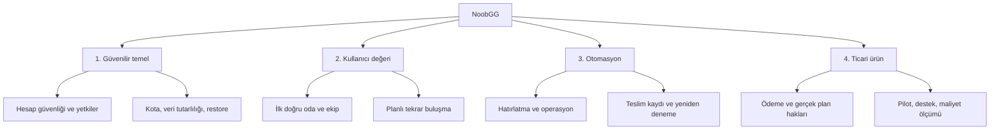
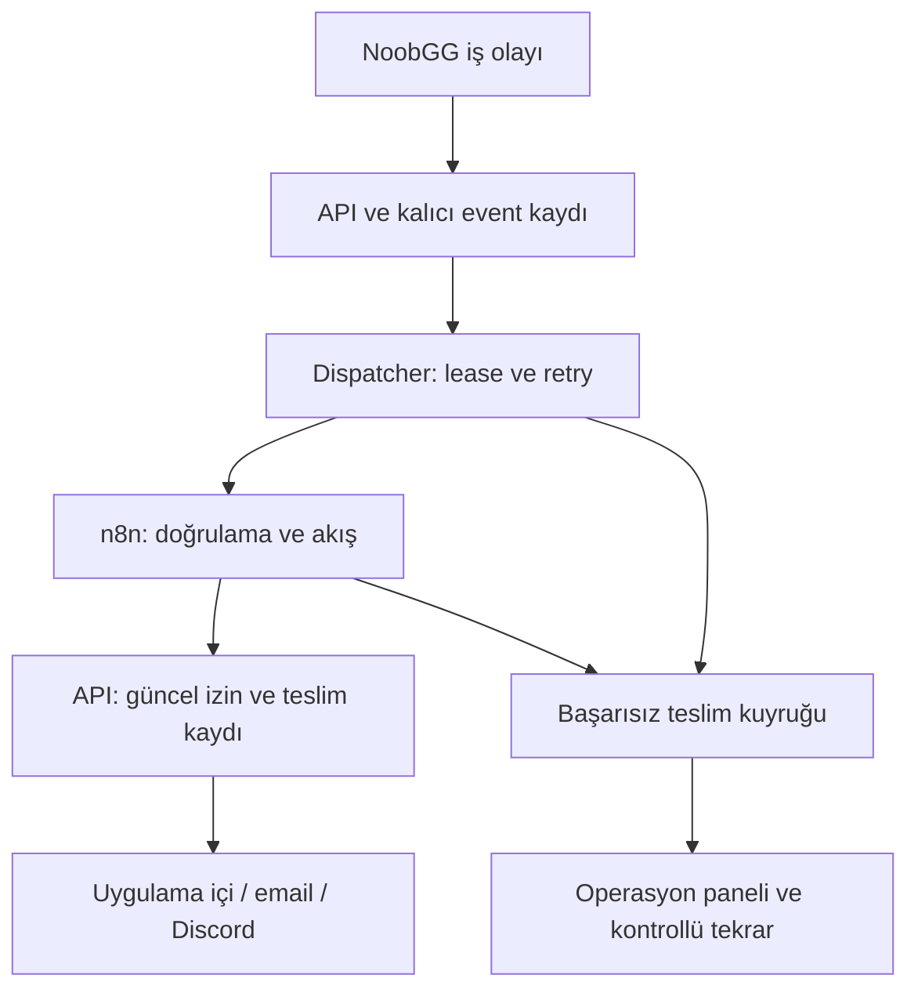

# NoobGG: ürün, güvenilirlik ve workflow yol haritası

Tarih: 10 Kasım 2026. Kaynak: mevcut NoobGG kodu, yerel doğrulama ve PR #2'nin GitHub Actions sonucu. Bu belge geliştirme önerisidir; önerilen özellikler ve dış entegrasyonlar kurulmuş sayılmaz. Önceki test/satış raporunu tamamlar; aynı gün yapılan ek düzeltmeleri ayrıca kaydeder.

## 1. Ürün kararı

NoobGG'yi ilk aşamada “uygun takım arkadaşını bul, birlikte oyna, iyi ekibi tekrar topla” döngüsüne odaklayalım. Oda, mesaj, lonca, forum ve turnuva modülleri zaten var. Öncelik yeni modül sayısını artırmak değil; mevcut döngünün güvenilir, ölçülebilir ve tekrar kullanılabilir olması.

Pilot önerisi: 2 oyun, tek ana dil/bölge grubu ve 3–5 topluluk yöneticisi. Bunlar talebi doğrulanmış hedefler değil, başlangıç hipotezidir. 200 sentetik kullanıcı ekranları göstermek ve test etmek içindir; gerçek talep, aktif kullanıcı veya gelir kanıtı değildir.

Ücretli açılış kararı şu an **beklemeli**: ödeme sağlayıcısı, sunucuda kota uygulaması, hesap kurtarma, auth abuse koruması, doğrulanmış rekabet sonucu ve üretim restore kanıtı tamamlanmadan fiyat ekranı satışa hazır ürün anlamına gelmez.

## 2. Bu turda ele alınan hatalar

Bu liste önceki özel oda/gizlilik, refresh token, abonelik iptali ve mobil DM düzeltmelerine ektir. Aşağıdaki değişiklikler için yeni regresyon kapsamı eklendi; nihai test sayıları PR açıklamasında ve çalışma tesliminde verilir.

| Kod | Önceki davranış | Düzeltme | Kanıt / sınır |
| --- | --- | --- | --- |
| F01 | Oyun içi ad create yanıtında görünse de entity'de alan yoktu; update ve sonraki GET'te kayboluyordu | Entity alanı, create/update kaydı ve iki profil GET eşlemesi tamamlandı; boş metinle temizleme mümkün | Gerçek MongoDB create/update/clear testi ve API üzerinden yeni okuma regresyonu |
| F02 | API restart'ı plan fiyatını, para birimini, limitleri ve pasiflik durumunu varsayılanlarla eziyordu | Seeder yalnızca eksik plan ekler | İki başlangıç sonrası özel fiyat/alanların ve üç planın korunduğu test; plan sürümleme hâlâ ayrı iş |
| F03 | Redis SET ile TTL iki ayrı çağrıydı; arada kesinti kalıcı cache bırakabilirdi | Değer ve süre tek Redis yazmasında | Gerçek Redis'te TTL ve süresiz yenileme testi |
| F04 | Beş dakikalık cache, abonelik bittiğinde ücretli hakkı taşımaya devam edebilirdi | Snapshot'a geçerlilik tarihi, son tarihle sınırlı TTL ve cache okurken tarih kontrolü | Saati ilerleten testte dönem sonunda Free; tarihsiz eski ücretli cache yeniden sorgulanır |
| F05 | Free kullanıcının hakları DB planından değil sabit koddan türetiliyordu | Aktif Free planı okunur; plan bulunamazsa güvenli varsayılan | Özelleştirilmiş Free limit/özellik testi |
| F06 | GitHub CI açılış anındaki connection reset hatasını yeniden denemeden kesiyordu | Tüm bağlantı hataları için süreli retry, gerçek readiness adresi, hata halinde Compose logları | Önceki CI logunda curl exit 56 görüldü; yeni CI sonucu ayrıca izlenmeli |
| F07 | Health her durumda healthy dönüyordu | Ayrı `/api/health/ready` MongoDB ve Redis'i süre sınırıyla yoklar; hata 503 | Sağlıklı bağlantı ve erişilemeyen MongoDB testi; `/api/health` liveness olarak korunur |
| F08 | Compose'ta kullanıcı upload'ları API container'ıyla kaybolabiliyordu | Upload volume; MongoDB/Redis için healthcheck ve sağlıklı bağımlılık bekleme | Yapılandırma eklendi; container yeniden oluşturma/restore tatbikatı ayrıca yapılmalı |

## 3. Açık hata ve risk kuyruğu

P0 kontrollü pilot veya ücretli açılış öncesi zorunlu; P1 ilk kullanıcı döngüsünü güçlendirir; P2 ölçüm sonrası yatırım. Aşağıdaki işler henüz bitmiş değildir.

| ID | Öncelik | İş / kod dayanağı | Bitti sayma kriteri | Bağımlılık | Yaklaşık efor |
| --- | --- | --- | --- | --- | --- |
| G01 | P0 | `CreateRoom` günlük kotası ve `AddGameProfile` plan kotası komutlarda uygulanmıyor | Free/Plus/Pro limitleri sunucuda; eşzamanlı istek sınırı aşamıyor; silinen oda günlük sayacı sıfırlamıyor; UTC gün sınırı belgeli | Kalıcı usage ledger, atomik slot rezervasyonu; tüm yazma yolları envanteri | 4–6 gün |
| G02 | P0 | Auth/OTP deneme sınırı ve resend cooldown eksik | IP ve hesap bazlı sınır, OTP deneme sayısı, genel yanıtlar, çoklu instance testi | Güvenilir proxy/IP ayarı, paylaşılan sayaç | 3–5 gün |
| G03 | P0 | Forgot/reset password tam akışı yok | Süreli tek kullanımlık link, eski link tekrar kullanılamaz, oturum iptali, gerçek e-posta teslimi | SMTP/domain ve G02 | 3–5 gün |
| G04 | P0 | `RecordMatchResult` tek kullanıcının beyanıyla rakibin puanını değiştiriyor | Katılımcı doğrulaması + karşı onay/uyuşmazlık + tekrar koruması; iki puan ve sonuç tutarlı yazılır | Session/result kimliği; transaction veya kalıcı toparlanabilir işlem tasarımı | 5–8 gün |
| G05 | P0 | Gerçek ödeme yok; callback toparlanması tamamlanmamış | Satın alma, yenileme, iptal, iade, tutar/para birimi doğrulama, aynı event tekrarında tek hak | Sağlayıcı hesabı, plan/sipariş snapshot'ı, G01 | 8–12 gün + sağlayıcı süresi |
| G06 | P0 | Hesap silme talebi veri yaşam döngüsünü tamamlamıyor | Export, retention, anonimleştirme, durum takibi, yedekten dönüşte silme talebinin korunması | Veri envanteri, ürün/retention kararı | 4–7 gün |
| G07 | P0 | Yedek, dosya doğrulama, izleme ve restore kanıtı eksik | DB+dosya restore tatbikatı; upload içerik doğrulaması; alarm; geri alma adımı | Staging/production altyapısı | 4–6 gün |
| G08 | P1 | Büyük App bundle; gerçek mobil cihaz kapsamı eksik | Route bazlı bölme, chart/3D lazy yükleme; önce/sonra ölçüm; iPhone Safari ana akış testi | Cihaz ve performans tabanı | 3–5 gün |
| G09 | P1 | Presence tek instance; event reminder teslim güvenilirliği sınırlı | Paylaşılan heartbeat/expiry; alıcı bazlı idempotency ve retry; çift reminder yok | Delivery store, opsiyonel workflow temel katmanı | 4–7 gün |
| G10 | P1 | Plan değişiklikleri için sürümleme/cache invalidation politikası eksik | Eski sipariş koşulları korunur; yeni fiyat yeni satışa uygulanır; admin değişimi cache'i geçersizleştirir | G05 tasarımı | 2–4 gün |

Eforlar yaklaşık odaklı geliştirici günüdür; toplamları sprintlere eklenebilecek kesin teslim tarihleri değildir. Tasarım, QA, şirket/sağlayıcı onayı ve entegrasyon bilinmeyenleri ayrıca süre ister. G01/G04'te yalnızca “count et, sonra insert et” yaklaşımı eşzamanlılığı çözmez.

## 4. Mevcut modüller üzerine özellik haritası

| Öncelik | Geliştirme | Bugün ne var? | Ne ekleyeceğiz? | Kullanıcıya değer / kabul kriteri |
| --- | --- | --- | --- | --- |
| P1 | Daha kısa ilk eşleşme | Onboarding, oyun profili, keşif ve Quick Match mevcut | 3 adımlı oyun/rol/saat seçimi, önerinin gerekçesi, boşlukta alternatif oda | Yeni kullanıcı ilk uygun odayı bulabilsin; kayıt → ilk oturum süresi ölçülsün |
| P1 | Kalıcı ekip | Arkadaş/favori ve oturum geçmişi mevcut | 3–5 kişilik ekip kaydı, tek tık tekrar davet, ortak müsaitlik | Başarılı bir oturumdan sonra aynı ekiple ikinci oturum kurulabilsin |
| P1 | Tekrarlayan buluşma | Guild event ve RSVP mevcut | Haftalık tekrar, saat dilimi, takvim dosyası, iptal/erteleme, güvenilir hatırlatma | Saat değişimi ve iptal gönderimden önce doğrulansın; çift davet oluşmasın |
| P1 | Kayıtlı arama | Oda ve oyuncu filtreleri mevcut | Filtreyi kaydet, uygun yeni oda için cooldown'lu bildirim | Güncel gizlilik/block/kapasite kontrolünden geçen tek bildirim |
| P1 | Guild yöneticisi çalışma alanı | Guild detay, rol, sohbet ve stats mevcut | Başvuru kuyruğu, katılım trendi, pasif üye görünümü, etkinlik dönüşümü | Yönetici hangi etkinliğin gerçek katılım ürettiğini görebilsin |
| P1 | İletişim tercihleri | Uygulama içi bildirim mevcut; email/push ayarları tamamlanmamış | Kanal/olay tercihi, sessiz saatler, abonelikten çıkış, teslim geçmişi | Kapalı kanal veya sessiz saatte uygun olmayan mesaj gitmesin |
| P2 | Discord köprüsü | OAuth/bot bağlantısı henüz yok | Guild kanal bağlantısı, sınırlı izinli bot, etkinlik duyurusu | Yalnızca yetkili yönetici kanal bağlasın; bağlantı kaldırılınca teslim dursun |
| P2 | Güvenilir oyuncu sinyalleri | Session feedback ve raporlar mevcut | Yalnızca gerçek ortak oturum sonrası değerlendirme, itiraz ve karşılıklı spam koruması | Dışarıdan rastgele puanlama yok; rapor sayısı tek başına otomatik ceza vermesin |
| P2 | PWA ve web push | Responsive web arayüzü mevcut | Manifest, güncelleme deneyimi, izinli push, bağlantı zayıfken anlaşılır durum | Desteklenen cihazda kurulum ve izin iptali testli; mesaj yazma için sahte offline başarı yok |
| P2 | AI guild özeti | Sohbet/forum içerikleri mevcut | Seçili herkese açık içerik veya izinli guild verisinden haftalık kısa özet | Kaynağa bağlantı, düzenleme/onay, veri ve maliyet sınırı |
| P2 | Sezon ve turnuva operasyonu | Turnuva, bracket, sonuç onayı ve sezon altyapısı var | Check-in, no-show, itiraz kuyruğu, takvim, organizatör raporu | Sonuç uyuşmazlığı denetlenebilir; katılımcı/organizatör rolü sınırları korunur |
| Sonra | Sponsor, pazar yeri, native uygulama | Henüz ayrı iş modelleri | Pilot tutma ve talebe göre keşif | Önce kullanım/ödeme isteği kanıtı; ilk lansmanın bağımlılığı değil |

## 5. Workflow bağlasak ne olur?

Öneri: başlangıçta yalnızca ekibin yönettiği n8n ile bildirim ve operasyon akışlarını deneyelim. Oda kapasitesi, eşleşme kararı, ELO yazımı, gizlilik ve ödeme hakkının sahibi .NET API olsun. n8n kesilince oyuncu oda kurabilmeli; bildirim kuyruğu sonradan toparlanabilmeli.

| Seçenek | NoobGG'de uygun kullanım | Başlangıç kararı |
| --- | --- | --- |
| Mevcut .NET background job | Az sayıda sabit görev, API'ye yakın tutarlılık ve tek ürün akışı | Çalışan basit işleri koru; sırf otomasyon adı olsun diye taşıma |
| n8n | Email/Discord/ops bağlantıları, dallanan hatırlatma, ekip tarafından sık değişen iş akışları | İlk 3 akış için önerim; ayrı servis ve erişim sınırı |
| Elsa benzeri uygulama içi workflow | İleride guild yöneticisinin ürün içinden kural tasarlaması | Talep doğrulanırsa teknik keşif; ilk sürüme iki workflow motoru ekleme |

**Bağlantı sözleşmesi:** Önerilen envelope: `eventId`, `eventType`, `schemaVersion`, `occurredAt`, `aggregateId`, `correlationId` ve minimum `data`. Mesaj gövdelerini, parola/token veya ödeme verisini genel event payload'ına koyma. Event sadece “bir şey oldu” sinyalidir; gönderimden hemen önce API güncel üyelik, block ve tercihleri yeniden kontrol eder.

**Teslim garantisi:** En az bir kez teslim varsayılır. `eventId + workflowVersion + recipientId + channel` benzersiz delivery anahtarı; atomik sahiplenme; kısa lease; artan bekleme; sınırlı deneme; başarısız kuyruk ve tekrar deneme ekranı. Dış sağlayıcı isteği alıp yanıt kaybolursa, sağlayıcının idempotency desteği yokken mutlak “tam bir kez email” garantisi verilmez. Bu belirsiz sonuç ayrı durumda tutulmalı ve kör tekrar sınırlandırılmalı.

**Veritabanı şartı:** Mevcut Compose MongoDB standalone. Domain değişikliği + ayrı outbox belgesini atomik yazdığımızı iddia edemeyiz. Üretim tasarımında replica set/transaction ile iki yazıyı bağla veya aynı aggregate belgesinde pending-event ve güvenilir reconciliation tasarla. Geliştirme sırasında bu karar verilmeden event kaybı çözülmüş sayılmaz.

**Yetki:** Üretimde HTTPS; ayrı servis kimliği ve dar callback izinleri. Webhook'ta header authentication veya gateway'de raw body/timestamp/eventId üzerinden HMAC ve replay kontrolü. n8n'in Webhook node'u HMAC doğrulamasını kendiliğinden yapıyor varsayılmamalı. DB'ye n8n'den doğrudan plan/ban/puan yazma. Test ve production webhook adresleri farklıdır [1].

**İzleme:** Her workflow için son başarı, bekleyen/başarısız teslim, gecikme ve tekrar sayısı. n8n Error Trigger merkezi hata akışına bağlanabilir [2]. Hata akışı bozulunca aynı kanala bağımlı olmayan bir health alarmı da gerekir.

## 6. İlk akışlar ve gerçek kullanım senaryoları

| Sıra / akış | Tetik | Adımlar | Ön şart / sahip | Başarı ölçütü |
| --- | --- | --- | --- | --- |
| W01 / İlk | Etkinliğe 30 dakika kaldı | Güncel event al → iptal/RSVP/üyelik kontrolü → sessiz saat/kanal → teslimi sahiplen → gönder → kaydet | Tercihler ve delivery store; backend + topluluk yöneticisi | Retry testinde çift uygulama içi kayıt yok; iptal edilmiş event duyurulmuyor |
| W02 / İlk | `report.created` | Aynı raporları grupla → öncelik ver → moderatör kuyruğu → insan kararı → API audit | Mevcut moderation; backend + moderatör | Rapor daha hızlı inceleniyor; AI/otomasyon kendisi ban vermiyor |
| W03 / İlk | Readiness veya hata eşiği | Tekrarları grupla → cooldown → operasyon kaydı/uyarı → çözülme bildirimi | Gerçek alarm kanalı ve yetki; operasyon sorumlusu | Test kesintisi görünür; aynı hata 100 kez gelince 100 alarm yok |
| W04 | Doğrulanmış ama profil/ilk oturum eksik kullanıcı | İzinli kanalı kontrol et → eksik adıma özel yardım → dönüşümü ölç → kullanıcı tamamladıysa dur | G02/G03 ve iletişim tercihleri; ürün + backend | Aynı adımı bitiren kullanıcıya hatırlatma yok; mesaj sayısı sınırlı |
| W05 | Yeni uygun oda | Kaydedilmiş arama sahiplerini bul → gizlilik/block/kapasiteyi doğrula → cooldown → deep link | Kayıtlı arama + API görünürlük denetimi | Özel oda bilgisi sızmıyor; bildirimden gerçek katılıma dönüşüm ölçülüyor |
| W06 | Haftalık guild özeti | Toplu istatistik al → kurallı veya AI özet → yönetici onayı → seçili kanal → arşiv | Güvenilir analytics ve varsa AI anahtarı; guild yöneticisi | Kullanım ve maliyet ölçümü; izin dışı DM içeriği işlenmiyor |
| W07 | Doğrulanmış ödeme başarısızlığı | API'den doğrula → retry/bilgilendirme politikası → destek kuyruğu → mutabakat | G05; ödeme operasyonu | n8n hak atamaz; aynı event çifte bildirim/abonelik üretmez |
| W08 | Turnuva kayıt kapanışı / check-in | Katılımcı uygunluğu → hatırlatma → no-show kuyruğu → organizatör kararı | G04 ve turnuva kuralları; organizatör | Maç kazananı zamanlayıcıdan uydurulmaz; itiraz yolu açık |

W01 mevcut `GuildEventReminderJob` ile aynı event/alıcı için iki kez çalışmamalı. Geçişte tek gönderim sahibi seçilir ve feature flag ile yönlendirilir. W02 için ilk aşamada kurallı öncelik yeterli; AI zorunlu değildir.

## 7. n8n kurulumu ve kapsamı

1. Ayrı staging instance, kalıcı veri ve encryption key; TLS ve yönetici erişimi. Başlangıçta tek instance yeterli bir pilot hipotezidir; kapasite testiyle karar verilir.
2. Versiyonu sabitle; credential değerlerini git'e koyma. Workflow export'larında sır bulunmadığını kontrol et. Yedek ve geri alma denemesi yap.
3. API'ye teslim/callback sözleşmesi ve event doğrulama katmanı ekle. Staging'de sentetik alıcı/sandbox kullan.
4. İlk W01'i iptal, RSVP değişimi, servis kesintisi, yinelenen event ve zaman dilimi testleriyle tamamla.
5. Sonra W02/W03. Gerçek dış bildirim kanallarını hedef hesaplar ve tercihler netleşince aç.
6. Yük gerektirirse queue mode'a geç: n8n ana servis + worker + Redis + uygun kalıcı DB ve ortak encryption key. Queue mode belgeleri bu bileşenleri tanımlar [3]. NoobGG'nin Redis'ini kontrolsüzce ortak kuyruk/veri alanı olarak kullanma.

Bu çalışma n8n servisi kurmaz, Discord/email bağlantısı açmaz ve gerçek kişilere mesaj göndermez. Amaç uygulanabilir plan ve teknik sözleşmedir.

**Ticari kullanım ayrımı:** Ekibin içeride yönettiği akışlar ile müşterinin akış oluşturup değiştirebildiği bir ürün farklı lisans kapsamına girebilir. n8n'in güncel açıklaması dış kullanıcıya workflow oluşturma/yapılandırma imkânında ticari lisans gereksinimi belirtiyor [4]. Guild yöneticisine “kendi otomasyonunu tasarla” satmadan önce kapsamı sağlayıcıyla netleştir. Bu önerinin ilk sürümü ekip tarafından işletilen sabit akışlardır.

## 8. Gelir ve paket önerisi

Önce sınırlı ücretsiz pilot; sonra ödeme isteğini test eden teklif. Mevcut kod fiyatları (`4.99 / 9.99 USD`) pazar doğrulaması değildir. Kesin TL/USD fiyatı kullanıcı görüşmesi, ödeme gideri ve servis maliyeti görülmeden belirlemeyelim.

| Paket hipotezi | İçerik | Satış ön şartı |
| --- | --- | --- |
| Free | Temel eşleşme, oda, arkadaş, mesaj, engelleme/raporlama | Güvenlik ve temel iletişim herkese açık; sunucu kotaları net |
| Plus | Kayıtlı aramalar, tercihli bildirim, tekrar ekip, kişiselleştirme | Özellik gerçekten çalışıyor; ücretli durum ve downgrade davranışı testli |
| Guild / Pro | Yönetim paneli, etkinlik otomasyonu, gelişmiş katılım analizi | Yönetici değerini doğrulayan pilot; normal oyuncudan ayrı paket testi |

ELO veya sıralama üstünlüğünü para karşılığında satmayalım. “Boost / priority” mevcut feature anahtarları yalnızca backend gerçekten uyguluyorsa ve rekabeti etkilemesi ürünce açıkça kararlaştırılmışsa vaat edilmeli. İlk ticari odak olarak guild yöneticisine zaman kazandıran araçlar, oyuncuya yalnızca rozet satmaktan daha ölçülebilir bir hipotezdir.

Maliyet hesabı: aktif kullanıcı × olay sayısı × alıcı fan-out × kanal maliyeti. Örnek yük varsayımı: 1.000 kullanıcı × ayda 20 aktif gün × günde 2 olay = 40.000 domain olayı; bu sayı n8n execution veya email sayısı değildir. Batch, workflow tetik tasarımı ve bildirim tercihleri bunları değiştirir. Altyapı, email, observability, ödeme komisyonu, AI token ve destek iş yükü ayrı ölçülür. Bu belge güncel servis fiyat teklifi değildir.

## 9. Bağımlılık ve yaklaşık takvim

Tek full-stack geliştirici ve kısmi QA desteği için 10–14 haftalık bir planlama bandı öneriyorum. Aşağıdaki sıra varsayımsaldır; P0 kriterleri gecikirse ücretli açılış ertelenir, takvim adına atlanmaz.

| Kilometre taşı | Yaklaşık dönem | Teslim | Çıkış kapısı |
| --- | --- | --- | --- |
| M0 | Bu çalışma | F01–F08, yeni regresyonlar, CI düzeltmesi, harita | Yerel kontroller; GitHub CI sonucunu ayrıca kontrol et |
| M1 | Hafta 1–3 | G01–G04: güvenlik, kotalar, kurtarma, sonuç güvenilirliği | Negatif/yarış testleri; tek taraflı ELO değişimi engelli |
| M2 | Hafta 3–5 | G06/G07, gözlemleme, veri politikası, workflow event/delivery temeli | Restore denemesi; event kaybı/tekrar testi |
| M3 | Hafta 5–7 | W01–W03, tercihler, planlı etkinlik iyileştirmesi | İptal/RSVP değişimi ve kesintide doğru teslim |
| M4 | Hafta 7–10 | Ekipte tekrar buluşma, kayıtlı arama, performans; gerçek kullanıcı beta | İlk oturum ve tekrar kullanım ölçümü; kritik hata yok |
| M5 | Hafta 10–14 | G05/G10 ödeme ve plan yaşam döngüsü; sınırlı ücretli pilot | Sandbox senaryoları + operasyon/destek; ölçülen maliyet ve ödeme isteği |

Sağlayıcı hesabı ve staging seçimi erkenden araştırılabilir; ücretli ürün davranışı diğer P0 işler bitmeden açılmaz. Bütün özellik tablosu bu takvime sığdırılmış değildir; P2 işler pilot verisine göre sonraya alınır.

## 10. İlk sprintin somut iş listesi

1. **G01 kota tasarımı:** Mevcut tüm oda açma yollarını (manuel, Quick Match, replay) çıkar. Kota tüketen olay, başarısız işlem iadesi, UTC gün sınırı ve downgrade kuralını yaz. Kalıcı atomik rezervasyon/usage ledger uygula; 20 eşzamanlı istekle limiti doğrula.
2. **G02 auth koruması:** Login/register/verify/resend için ayrı IP+hesap politikası ve paylaşılmış sayaç. Hesap varlığını sızdırmayan yanıt; doğru reverse proxy ayarı. OTP ve resend negatif testleri.
3. **G03 kurtarma:** Forgot/reset ekranları, hash'lenmiş tek kullanımlık reset token'ı, süre, kullanımdan sonra session iptali ve gerçek SMTP sandbox teslimi.
4. **G04 sonuç sözleşmesi:** API/frontend üzerinde unverified sonuçla public ELO artırma yolunu kapatacak ürün akışı; katılım doğrulama, karşı onay, itiraz ve güvenilir toplu yazım tasarımı. Kullanıcıya sonucu nasıl doğrulatacağını açık göster.
5. **Pilot ölçümü:** `signup_verified`, `profile_completed`, `room_joined`, `session_completed`, `repeat_squad_session` olaylarını tek tanımla; bot/demo kullanıcılarını metriklerden çıkar.

Sprint taahhüdü ilk 2 maddeyle başlatılmalı; 3–5 sonraki sıradır. Bir sprintte hepsini bitmiş varsaymayalım.

## 11. Başarı ölçümü ve satışa açılış kapısı

| Ölçüm | Tanım | Başlangıç kullanım kararı |
| --- | --- | --- |
| Aktivasyon | Yeni doğrulanmış kullanıcıların 7 gün içinde ilk tamamlanmış oturum oranı | İlk 2 haftada taban ölç; sonra iyileşme hedefi koy |
| Eşleşme kalitesi | Uygun oda bulma süresi + katılım → tamamlanan oturum | Bölge/oyun kırılımı; medyan ve p95 ayrı |
| D7 tutma | Yeni kullanıcı cohort'unun 7. gün aktivitesi | Sentetik veriler hariç; özellik öncesi/sonrası karşılaştır |
| Ekipte tekrar | Ortak oturumu olanların 14 günde aynı ekiple tekrar oranı | Kalıcı ekip özelliğinin ana sonucu |
| Güven | Tamamlanan oturum başına doğrulanmış rapor, karar ve itiraz süresi | Salt rapor sayısını başarı/başarısızlık kabul etme |
| Workflow | Teslim gecikmesi, başarısız/tekrar teslim, tercih ihlali | Yinelenen event ve kesinti testlerinde kayıp/çift kayıt olmamalı |
| Ekonomi | Aktif guild başına gelir ve servis/destek maliyeti | Gerçek pilot maliyeti ve ödeme isteği; rozet tıklaması satış kanıtı değil |

Ücretli açılış kapısı: açık P0 yok; sandbox ödeme/iptal/iade tekrarı geçti; gerçek SMTP teslimi geçti; dosya/DB restore tatbikatı yapıldı; müşteri destek/iade/veri silme süreçleri uygulanabilir; kritik akışlar için tarayıcı/rol matrisi ve yük testi mevcut. Bu belge bu kapının bugün geçildiğini söylemez.

## 12. Doğrulama kapsamı ve kaynaklar

Bu turda MongoDB ve Redis açıkken **29 backend testi geçti**. İstemci lint ve production build başarılı; yaklaşık 1,8 MB App chunk uyarısı sürüyor. Profil adı için yeni regresyon dahil masaüstü/mobil Playwright turunda **29 başarılı, 1 kasıtlı atlanan test** var. Atlanan test moderasyon yaptırımının mobil projede tekrar edilmemesidir.

Yerel otomasyon gerçek Chromium ile masaüstü ve Pixel 7 viewport emülasyonudur; fiziksel iPhone/Safari testi değildir. Playwright MCP sağlanmadığından Playwright Test kullanılır. Docker yaşam döngüsü/restore ile gerçek SMTP/ödeme testleri ayrı doğrulama ister. Önceki CI'da server işi geçti, client build/lint geçti, ancak API bekleme adımı erken kesildi; bu durum “Playwright GitHub'da geçti” diye sunulamaz.

- [1] n8n Webhook, authentication ve test/production URL: https://docs.n8n.io/integrations/builtin/core-nodes/n8n-nodes-base.webhook/
- [2] n8n hata akışları / Error Trigger: https://docs.n8n.io/flow-logic/error-handling/
- [3] n8n queue mode: https://docs.n8n.io/hosting/scaling/queue-mode/
- [4] n8n güncel lisans kullanım açıklaması: https://support.n8n.io/article/can-i-use-your-license-for-my-use-case
- MongoDB insert-only upsert davranışı: https://www.mongodb.com/docs/v7.0/reference/operator/update/setoninsert/
- Kod referansları: `PlanSeedInitializer`, `EntitlementService`, `RedisCacheService`, `HealthController`, profil create/update/query handler'ları, `.github/workflows/ci.yml`, `docker-compose.yml`.

Önerilen sonraki somut geliştirme paketi: **G01 + G02**, ardından kurtarma/sonuç güvenilirliği ve W01. İlk üç workflow için hedef dış kanallar belirlenmeden gerçek kullanıcı bildirimi açılmamalı.
